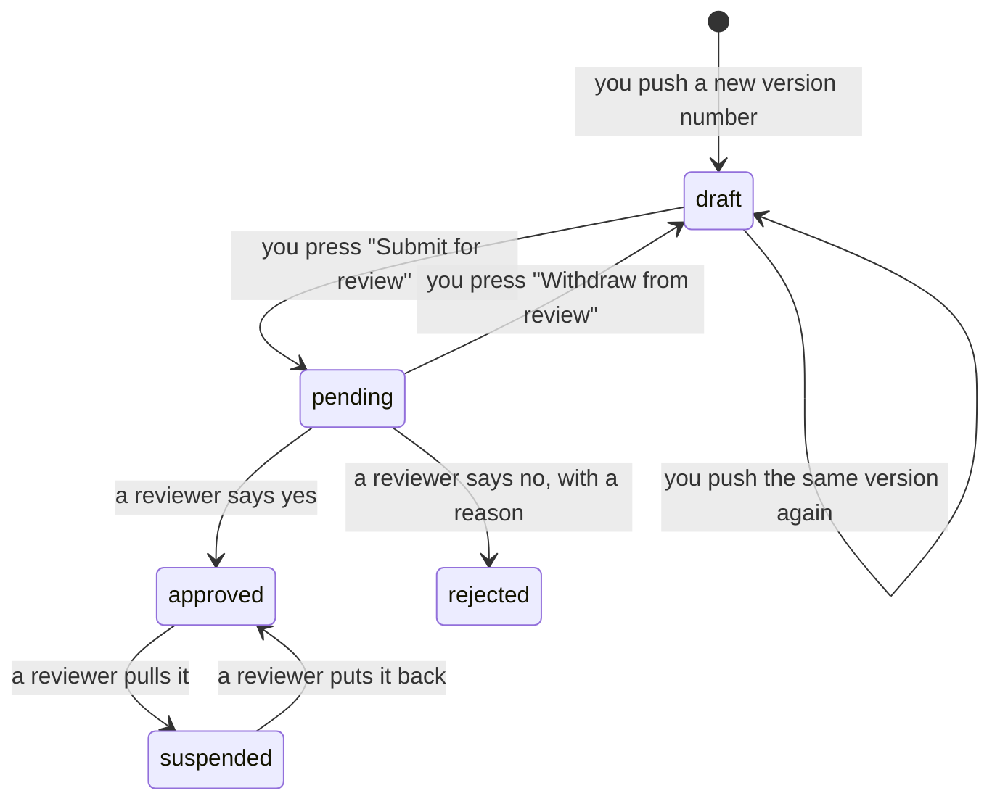
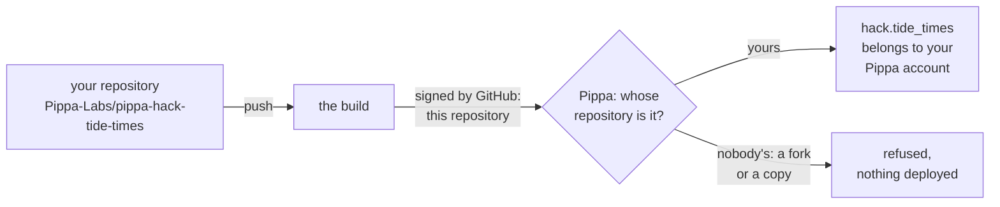
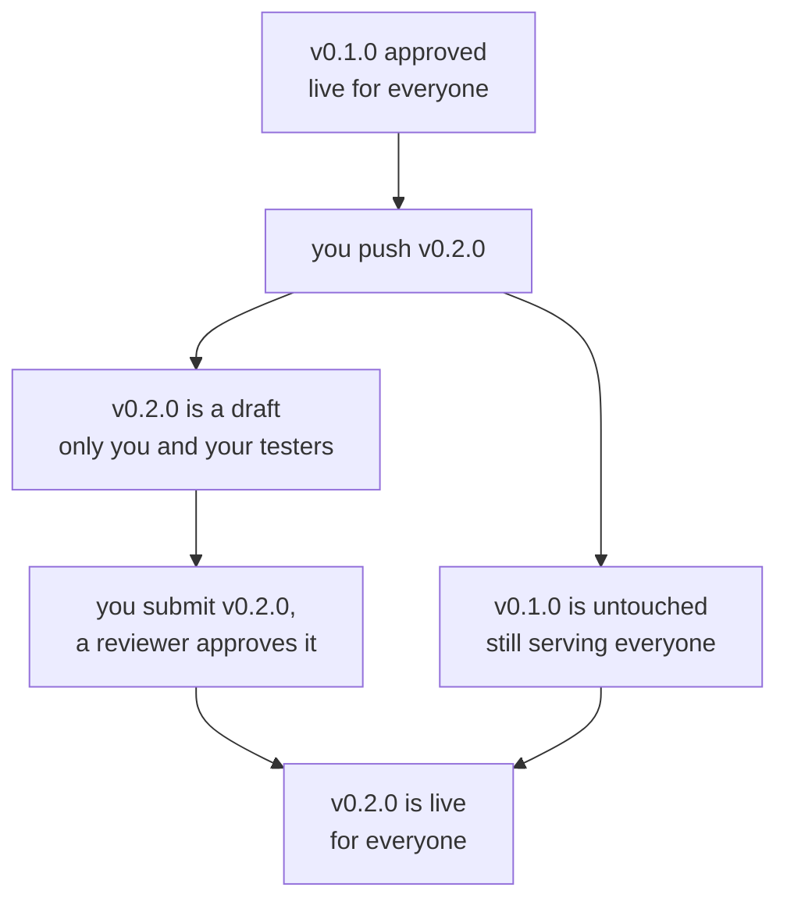

# Who can see your app, and how it becomes public

Publishing your app no longer makes it public. From the moment it publishes it
is **private to you**: you can install it, test it and use it in Pippa exactly
as a stranger would, and nobody else can see that it exists. It becomes public
when a reviewer approves it, and not before.

That is a change in what "live" means, and it is worth two minutes of reading,
because almost everything confusing about it comes from expecting the old
behaviour.

## Why it works this way

Anyone can push an app into a real assistant used by real people. Until now
the only thing between a student's first commit and everybody's Pippa was a
manifest check. Review puts a person in that gap.

The cost is one button at the end. The thing it buys is that you can push
twenty times in an afternoon, try each one properly inside Pippa, show it to a
friend, and still decide not to inflict it on anyone.

## The five states

Every version of your app is in exactly one of them. The Apps page calls them
by the names in the last column.

| State | Who can see and run it | How it gets there | On the Apps page |
|---|---|---|---|
| **draft** | you, your testers, the reviewers | you push a version number for the first time, or withdraw it from review | Draft |
| **pending** | the same people — submitting changes nothing for users | you press Submit for review | In review |
| **approved** | everybody | a reviewer says yes to a version you submitted | Live; or Approved — not live, once a newer approved version is live |
| **rejected** | you, your testers, the reviewers | a reviewer says no, and writes why | Changes needed |
| **suspended** | nobody, including you | a reviewer pulls an approved app | Suspended |



Three things that catch people out:

- **A version has its own state, and its own code.** Pippa keeps a copy of the
  code of every version you publish. `0.1.0` can be approved and public,
  answering everybody with its own code, while `0.2.0` sits in draft, private
  to you. That is what makes updating safe — see [Changing an app that is
  already approved](#changing-an-app-that-is-already-approved).
- **Submitting changes nothing a user would notice, but it freezes the
  version.** Pending is as private as draft, and the version installed for you
  stays installed. Submitting is a message to the reviewers, not a change to
  the app. What it does change is that the version's code can no longer be
  replaced: from then on, a change needs a new version number. See [After you
  submit](#after-you-submit).
- **Your latest version is the one you pushed most recently**, not the one
  with the highest number. Pippa never compares version numbers: push `0.1.5`
  after `0.2.0` and `0.1.5` is your latest.

## Versions, and which one each person gets

Every push publishes one version: the number in `version:` under `app:` in
`manifest.yaml`. Pippa keeps that version's code, and a push of a different
version number never changes it. A version goes on doing what it did when you
pushed it.

Only a **draft** can change. Push a draft's version number again and that
version is replaced, code and manifest together, as often as you like.
Everybody on that version — you, and your testers if they get it — has the new
code straight away. From the moment you submit a version, it is frozen.

Which version answers depends on who is asking:

| Who | Which version they get |
|---|---|
| **You** | the version installed for you — or your latest version, while **Always use my latest version** is on |
| **Your testers** | the version you choose for them: your latest version, unless you pick another |
| **Everybody else** | the **live** version: the approved version you pushed most recently. Until a version is approved, nobody else has your app at all |

When the version somebody should get changes — a newer version is approved,
or you push while your testers get your latest — they move to it the next time
they ask. The exception is a version that adds an outcome, something new
people can ask it to do. Nobody gets that without agreeing to it, and Pippa
does not ask them by itself: they keep the newest version they have agreed to,
and their Apps page shows an **Update** button on your app
(**Update to v0.3.0**, say). Pressing it shows them what the new version can
do, and installs it once they agree. Your own install is different again: it
stays on its version until you change it, unless **Always use my latest
version** is on.

### Your app's card

Open [app.getpippa.ai/apps](https://app.getpippa.ai/apps) and choose
**Created by me**. Every app you own has one card there, and its first lines
answer the questions that matter:

- **Installed for you** — the version you get in chat. For example
  `v0.2.0 · Draft`; or `Always your latest — now v0.3.0 · Draft` while
  **Always use my latest version** is on; or `Not installed`.
- **Live for everyone** — the version everybody else gets, such as
  `v0.1.0 · Approved`, or `Not public yet`.
- **Latest version** — the version you pushed most recently, shown only when
  it is not the one installed for you.
- **Testers get** — which version your testers get, shown once you have
  testers.

Under **Versions** is every version you have pushed, newest first, each with
its state and a mark on the one installed for you. Each version has the
buttons that apply to it: **Install this version**, **Submit for review** or
**Withdraw from review**, and **View changes**, which lists what that version
changes compared with the live one, and says whether the people who have your
app would have to press **Update** to get it.

### Installing a version is how you test it

The version that answers you in chat is the one installed for you, and
nothing else. Publishing a new version does not change it, and neither does
submitting one. So after you push a new version number:

- press **Update to latest** on your app's card, or
- press **Install this version** next to the version you want, under
  **Versions**, or
- switch on **Always use my latest version**. Then every push is what you get
  in chat, with no reinstalling — the easiest way to work while you are
  building. Switching it off keeps you on the version you had a moment
  before.

If the version installed for you is a draft and you push it again under the
same number, you need none of this: the version you have is the one that
changed.

### The badge names the version that answered

When your app answers, the badge on the reply names the version that did:
**via Tide Times 0.2.0**. On your own app, a version that other people do not
get is marked as well — **your draft**, or **not live** — and the badge's
tooltip says which version everybody else gets. If the badge names a
different version from the one you just pushed, the version installed for you
is not your latest: see [Installing a version is how you test
it](#installing-a-version-is-how-you-test-it).

Routing follows the version too. Pippa decides whether your app should answer
from the manifest of the version that person gets, so a new example phrase in
`0.2.0` changes nothing for somebody still on `0.1.0`.

### Code not kept

A version published before Pippa kept a copy of each version's code is marked
**Code not kept**. It cannot be installed or run. If it is still a draft, push
it again under the same number and it becomes an ordinary version; otherwise
change `version:` and push. If it was your approved version, the people who
installed your app cannot use it until a newer version is approved, so submit
one.

## Testing it while it is private

Exactly as you would test a public app, which is the point.

1. Open **[app.getpippa.ai/apps](https://app.getpippa.ai/apps)** signed in
   with the Pippa account your invitation was for: the one your repository
   belongs to.
2. Choose **Created by me**. Your app has a card there because you own it; it
   is not there for anyone else. Press **Install**, which installs your latest
   version. (On **Public apps** your app says **Your app — manage it in
   Created by me** instead.)
3. Ask Pippa one of your example phrases in the chat.

It runs the same way it will on the day it is public: same sandbox, same
twenty seconds, same manifest enforcement, same routing. Nothing about a
private app is a simulation, so a private app that works is an app that works.

### Your repository is what makes it yours

Pippa Labs created your repository for your Pippa account, and Pippa keeps
that link on its own side. When you push, the build proves to Pippa which
repository the push came from, with a token signed by GitHub that nothing in
the repository can change. Every app published from your repository belongs
to your account. Nothing in `manifest.yaml` says who owns the app, and nothing
needs to: in a public repository, that is also nothing for anybody to read.



Three things follow.

- **Only your repository can publish your app.** A fork or a copy cannot
  publish at all. Pippa refuses it before anything is deployed: *This
  repository isn't linked to a Pippa builder account, so it can't publish.*
- **Your account has to exist first.** If you were invited and have not
  created your Pippa account yet, the push is refused with *This repository
  isn't linked to anyone's Pippa account yet.* Create it from your invitation
  email, then push again.
- **What people see is `app_author_name`**, the public name you chose for your
  app: a pseudonym, shown as "by <name>". It has nothing to do with who owns
  the app, and it is the only name of yours anybody sees.

An older `manifest.yaml` may still have an `owner_email` line. Delete it: in a
public repository Pippa refuses the push while it is there, because anybody
can read the address. `docs/TROUBLESHOOTING.md` has every one of these
messages, word for word.

## Letting somebody else try it

Add them as a **tester**, by email, from your app's card. A tester can see the
app, install it and use it while it is still private, at the version you
choose for them.

- Use the address they sign in to Pippa with. They need a Pippa account — a
  share is not an invitation to the platform.
- You can add them before they have ever signed in: a share is matched against
  the address, not against an account that has to exist yet.
- **A share is per app, and you choose the version.** **Testers get**, in the
  same dialog, is **Your latest version** unless you pick a particular one.
  Left on your latest, a share covers whatever you push next. Set to one
  version, your testers stay on it however much you push.
- Your testers find the app under **Shared with you for testing** on their own
  Apps page, which says which version they get.
- Testers cannot submit your app, cannot add other testers, cannot choose a
  version and cannot see any other app of yours. Those are yours alone.
- Removing a tester takes effect immediately: they lose your private versions
  at once. If your app has a live version, they keep that, like anyone who
  installed it. If it has none, the next thing they ask Pippa gets answered
  without your app.

This is the useful half of a hackathon demo: the person next to you asking
your app something you did not think of, before a reviewer ever sees it.

## Submitting it for review

**From Pippa, not from this repository.** Open your app's card at
[app.getpippa.ai/apps](https://app.getpippa.ai/apps), under **Created by me**,
and press **Submit for review** next to the version you want reviewed, under
**Versions**.

A reviewer can only approve a version you submitted. A draft is never
approved, so nothing you have not submitted can become public.

### There is no `scripts/submit.py`, and there should not be

It was considered and it cannot be built, for three separate reasons, any one
of which is enough:

1. **The repository has no credential that could submit.** Review lives behind
   a credential that only Pippa itself holds, and your repository does not
   have one. What the build has is a short-lived identity token it
   exchanges for permission to publish this one app and nothing else —
   deliberately, because that is the credential every hackathon repository
   holds.
2. **Submitting has to be done by a person, signed in.** The service decides
   who is submitting from a verified Pippa login, and it refuses a submission
   for an app the caller does not own. A script running in CI is not signed in
   as anybody.
3. **A credential that could submit would be a credential in a readable
   repository.** Your repository can be read, which is also why your app may
   not declare `secrets:` or `connectors:`. Submission is not worth making an
   exception for.

The build could in principle submit on your behalf with every push, and that
would be worse than having no script at all: a push is "here is my latest
attempt", and submitting is "this one is ready". They are not the same
sentence, and a reviewer's queue full of the first kind helps nobody.

So: push to publish, click to submit. Two actions, because they mean two
different things.

### What a reviewer sees

Everything in your manifest: the app's name, summary and author name, every
outcome with its example phrases, every input and output. Besides that, which
Pippa account the app belongs to and who you have shared it with. They do not
read your code.

Which makes the manifest worth a last read before you submit, this time as
prose. "Tidal predictions service" tells a reviewer nothing, the same way it
tells the routing model nothing.

### After you submit

Nothing in this repository can tell you the verdict. It appears against that
version on your app's card in Pippa — approved, or rejected with a reason you
can read.

The version you submitted is **frozen**. Its code cannot change while a
reviewer looks at it, or the thing they approved and the thing people run
could be different things. Pushing it again is refused:

```
Pippa refused to publish this app:

  hack.tide_times 0.1.0 is waiting for review, so its code can't change.
  Change `version:` in manifest.yaml (for example to 0.1.1) and push again —
  or withdraw 0.1.0 from review on the Apps page first.
```

So you can keep working while you wait, in a new version: change `version:`
(to `0.1.1`, say) and push. The new version is a draft, private to you and
your testers, and the one in the queue stays exactly as you submitted it.

To change the submitted version itself — a typo you spotted the moment you
pressed the button — press **Withdraw from review** next to it. It goes back
to being a draft: push the fix under the same number, then submit it again.
That works only while it is still waiting. Once a reviewer has decided, the
fix goes into a new version.

Submitting does not change what you get in chat, either. The version
installed for you stays installed.

## If it is rejected

A rejection comes with a reason, written for you, and shown with the version.
It is a request for changes rather than a verdict on you: a rejected version
is private, exactly like a draft.

It is also frozen, like every version a reviewer has seen, so the fix goes
into a new version. Pushing the rejected version number again is refused:

```
Pippa refused to publish this app:

  hack.tide_times 0.1.0 has been reviewed, so it is frozen. Change `version:`
  in manifest.yaml (for example to 0.1.1) and push again.
```

The rejected version cannot be submitted again either. There is no
resubmitting: it would send the reviewer the very code they said no to.
**Submit for review** is only ever offered on a draft.

So: fix the thing the reason names, change `version:`, push, try the new
version yourself, and press **Submit for review** next to the new version.

Only a draft can be replaced in place — a version you have not submitted, or
one you withdrew from review. That is what keeps the push-try-fix loop fast
before you submit: push the same version number as often as you like.

## Changing an app that is already approved

Once a version is approved, other people have it, and **that version is
frozen** like every version a reviewer has seen. Pushing it again is refused:

```
Pippa refused to publish this app:

  hack.tide_times 0.1.0 has already been approved and is in use. Bump the
  version in manifest.yaml and push again — the new version is yours to test
  privately, and the approved one keeps working for everyone until you submit
  it and it is approved in turn.
```

The fix is one line in `manifest.yaml`:

```yaml
app:
  version: 0.2.0     # was 0.1.0
```

The refusal is not bureaucracy. If an approved version could be replaced in
place, the thing a reviewer approved and the thing people are running would be
different things, and approval would mean nothing. It is also why Pippa keeps
every version's code: pushing `0.2.0` puts new code in `0.2.0` and leaves
`0.1.0`'s alone.



So an update costs nobody anything. Your approved app keeps answering
questions for everyone who has it while you break the new one as much as you
like. To try the new one yourself, install it — **Update to latest** on your
app's card — or switch on **Always use my latest version**.

When the new version is approved it becomes the live one, and people who have
your app move to it the next time they ask, with nothing to do. The exception
is a new version that adds an outcome. Nobody gets that without agreeing to
it, and Pippa does not ask them by itself: they keep the newest version they
have agreed to, and their Apps page shows them an **Update** button on your
app, which moves them to the new version once they agree. Either way, the old
version is then marked **Approved — not live** on your card.

## Suspension

A reviewer can pull an app that was approved. A suspended app disappears for
everybody — it is not listed, it cannot be installed, and it stops running for
people who had already installed it, including you. It covers every version of
the app.

That last part is the difference between suspension and every other private
state. The reason to suspend something is that it should stop, and "stops for
everyone except its author" is not stopping.

You will see the app and the reason on your own Apps page. Pushing is not the
way out: while the app is suspended, every push is refused, a new version
number included:

```
Pippa refused to publish this app:

  Tide Times is suspended by Pippa Labs, so new versions can't be published.
  Read the reason on the Apps page and talk to an organiser.
```

Resubmitting is not the way out either. It is a conversation with an
organiser, about the reason your Apps page shows.

## If your app is public the moment it publishes

Then review has been switched off for this event. Organisers can do that, and
it is not something wrong with your app. Everything in this page still
describes how it will behave when review is on; nothing you write needs to
change.

## Things that have not changed

- Pushing to `main` is still the deploy, and still the only one.
- The build still checks the manifest, runs your tests and refuses the same
  things it always did. See `docs/TROUBLESHOOTING.md`.
- Routing is unchanged. A private app competes for a question exactly as a
  public one does — against every other app *you* have installed.
- Your app still learns nothing about who is calling it. Who may run it is
  decided before your code is reached; `handle()` is handed inputs, as always.

## The short version

1. Push. The version publishes, privately.
2. Install it yourself — **Created by me** on the Apps page — and try it in
   Pippa. While you are building, switch on **Always use my latest version**,
   so that every push is what you get.
3. Add a tester or two by email, and let them break it. They get your latest
   version unless you choose another.
4. Press **Submit for review** next to the version when it is ready. From then
   on that version is frozen, and changes go into a new version number.
5. Approved, and it is live for everybody. Rejected, and you get a reason: fix
   it in a new version, push, and submit that one.
6. Changing an approved app: bump `app.version`, push, try it, submit the new
   version. The old one keeps working throughout.
